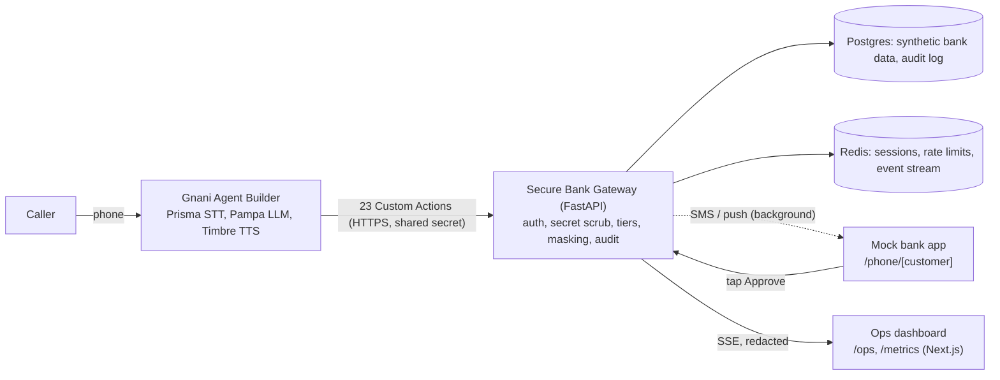

# LoanLoop

A secure voice service desk for borrowers of a lender, built on Gnani Agent Builder (Gnani Prisma STT, Pampa LLM, Timbre TTS). Entry for the Gnani Great Indian AI Internship Challenge.

**All data is synthetic. "Sahyadri Finance Bank" is a fictional lender; there is no real bank branding, account or customer data anywhere in this repo.**

## Problem

Indian lenders automate outbound calls, but borrower call-backs are still handled by people. Borrowers wait on hold, repeat themselves in their own language, cannot recall their own bank details, and are taught never to share secrets yet have no safe way to get help.

- RBI Ombudsman: 13.34 lakh complaints in FY 2024-25 (+13.55%); loans and advances are 29.25% of them.
- More than 70% of calls to RBI's contact centre are in Hindi.
- VoiceCodeBench (Aug 2026): the best of 12 ASR systems got every critical value right in only 68.7% of recordings.
- RBI recovery-conduct directions effective 1 Jan 2027 require logging call times and counts, with records kept 6 months.
- Of Gnani's 48 customer stories, 19 are outbound collections; none shows inbound servicing for a lender or several requests in one call.

## What LoanLoop does

Every request ends with an action completed in the bank's system, and the agent is safe by design: it never takes secrets, never sees full sensitive values, and sends anything sensitive only to the customer's registered phone.

- Secure details: branch IFSC lookup, IFSC validation, masked account/customer ID/mobile/email, full details by SMS to the registered mobile, password-reset guidance, spoken-secret interception.
- Loan servicing: EMI amount and due date, "I already paid" (read-back, ledger check, reconciliation ticket, reminders paused), why the EMI went up, EMI date change, foreclosure quote and closure request, statements and interest certificates, nominee and address updates, hardship handover.
- Several requests in one call without re-verifying; English, Hindi, Hinglish and Marathi with mid-call switching; warm handover with a structured case record when unsure.
- Every spoken figure comes from the gateway's `speak` text, built from the database, so the LLM cannot invent numbers.

## Architecture



Request flow: Agent Builder POSTs action inputs, the gateway authenticates, scrubs secrets, checks the tier, runs the action, writes the audit row, publishes a live event, and returns `{ok, speak, data, next, error_code}`. The agent speaks `speak` exactly. SMS and push go out as background tasks after the response.

## Security model

Tiers: **0** public info (branch lookup, IFSC check, reset guidance); **1** registered mobile + DOB or loan last 4 (masked values, EMI, SMS, hardship); **2** tier 1 + approval tapped in the mock bank app (amounts, payments, foreclosure, every data change); **3** never (passwords, PINs, OTPs, CVV, card numbers are never asked, accepted, stored or returned).

| CLAUDE.md section 6 rule | How it is enforced | Tests |
|---|---|---|
| 1 Secrets never collected | `security/scrub.py` scans every string in the raw body before validation (keywords, patterns, Luhn); returns `SECRET_DETECTED`; value is never stored or logged | `test_foundation.py`, `test_redact_leak.py` |
| 2 Masked outputs only | single module `security/mask.py`; last-4 columns so masking never decrypts | `test_foundation.py`, `test_details.py` |
| 3 Out-of-band delivery | SMS destination read from the DB, never from caller input | `test_details.py` |
| 4 Tiers in code | `security/tiers.py` table + runner check; upgrades only via `verify_caller` and approved app approval | `test_verify.py`, `test_approvals.py` |
| 5 Brute force | 3 failed verifications per call and per customer per hour, then handover only | `test_verify.py` |
| 6 Gateway auth | shared-secret header on every action, separate dashboard and phone tokens, CORS closed | `test_foundation.py`, `test_dashboard.py`, `test_phone.py` |
| 7 Read-back before change | one-shot confirmations recorded in the session; changes refuse without them | `test_loans.py`, `test_requests.py` |
| 8 No secrets in logs | global redaction filter incl. uvicorn access logs | `test_redact_leak.py` |
| 9 Injection resistance | strict Pydantic schemas, extra fields scanned, caller text is data | `test_foundation.py` |
| 10 Transcript minimisation | `tools/fetch_transcripts.py` redacts before storage | `tools/test_fetch_transcripts.py` |

Web: the dashboard proxy fails closed, `/gw/actions/*` is not exposed, and the browser only receives redacted data.

## Measured results

| Check | Result |
|---|---|
| Gateway tests | 170 pass (`cd gateway && uv run pytest -q`) |
| Tools tests | 11 pass (`uv run --project tools pytest tools/ -q`) |
| Call simulator (Priya + attacker) | all expectations met; transcript in `tools/out/simulate_transcript.txt` |
| Load test | see below |
| STT entity benchmark (Prisma v3 with vs without keyterms) | pending: needs Gnani API key |
| End-to-end voice-to-voice latency | pending: needs Gnani API key and live calls |

Load test: Locust, 1,000 concurrent simulated calls, spec think time 8-16 s (about 86 rps, inside the 50-125 rps target), 4 minutes, stats reset after ramp-up, 0 errors in about 18,900 requests.

| Scope | p50 | p95 | p99 |
|---|---|---|---|
| Overall | 14 ms | 33 ms | 49 ms |
| Worst action p95 (`start_call`) | 17 ms | 40 ms | 100 ms |

Target: p95 under 50 ms per action. Every action met it. Raw data: `tools/out/loadtest.json`. A stress run at about 457 rps (4x target) kept 0 errors but p95 rose to 120 ms (`tools/out/loadtest_stress_457rps.json`). These are single-box numbers: generator, gateway, Postgres and Redis share one machine.

## Quick start

```
cp .env.example gateway/.env          # then set ENCRYPTION_KEY (command in the file)
cp .env.example web/.env.local        # web needs the tokens and PHONE_TOKEN
docker compose up -d                  # Postgres :55432, Redis :56379
cd gateway && uv sync
uv run python ../tools/seed_data.py   # 200 synthetic customers (drops and recreates the dev DB)
uv run uvicorn app.main:app --host 127.0.0.1 --port 8000 --workers 4
cd ../web && npm install && npm run build && npm run start -- -p 3000

# simulated calls (reseed first; the seed is stateful)
uv run --project tools python tools/simulate_call.py --scenario all --base http://127.0.0.1:8000

# load test, details in tools/loadtest/README.md
cd gateway && uv run python ../tools/loadtest/fixtures.py --export && cd ..
LL_THINK=8,16 uv run --project tools python tools/loadtest/run.py --host http://127.0.0.1:8000
```

Use `127.0.0.1`, not `localhost`, on Windows. Pages: `/phone/priya` (mock bank app), `/ops`, `/metrics`.

## Agent Builder setup

See [docs/agent-builder-setup.md](docs/agent-builder-setup.md): tunnel, `agent/apply_agent.py`, the integration and 23 Custom Actions, and the open questions to check in the console.

## Layout

- `gateway/` FastAPI gateway: `app/routes/actions`, `security/`, `speak/`, `db/`, `events.py`, `tests/`
- `web/` Next.js mock bank app, ops dashboard, metrics
- `agent/` system prompt, `actions.json`, keyterms, `apply_agent.py`
- `tools/` seeding, simulator, STT corpus and benchmark, transcript fetch, `loadtest/`, `out/` results
- `docs/` Gnani facts, personas, dashboard API, Agent Builder setup; `NOTES.md` decisions and numbers

## Limitations

- A spoken secret reaches Gnani's STT/LLM pipeline before our gateway can scrub it. The gateway only guarantees it is never stored or logged by us and that the agent warns the caller.
- Several Agent Builder behaviours are NOT IN DOCS and unverified: conversation-id and caller-ID variables, verbatim reading of `speak`, action timeout range, Prisma v3 keyterms inside Agent Builder, after-call variable mapping (see `docs/agent-builder-setup.md` section 5).
- The load test is single-box (no network latency, no Gnani in the loop).
- No live Gnani calls, STT benchmark or end-to-end latency have been run yet.
- Mock bank only: no real SMS, push, core banking or credit decisions.
